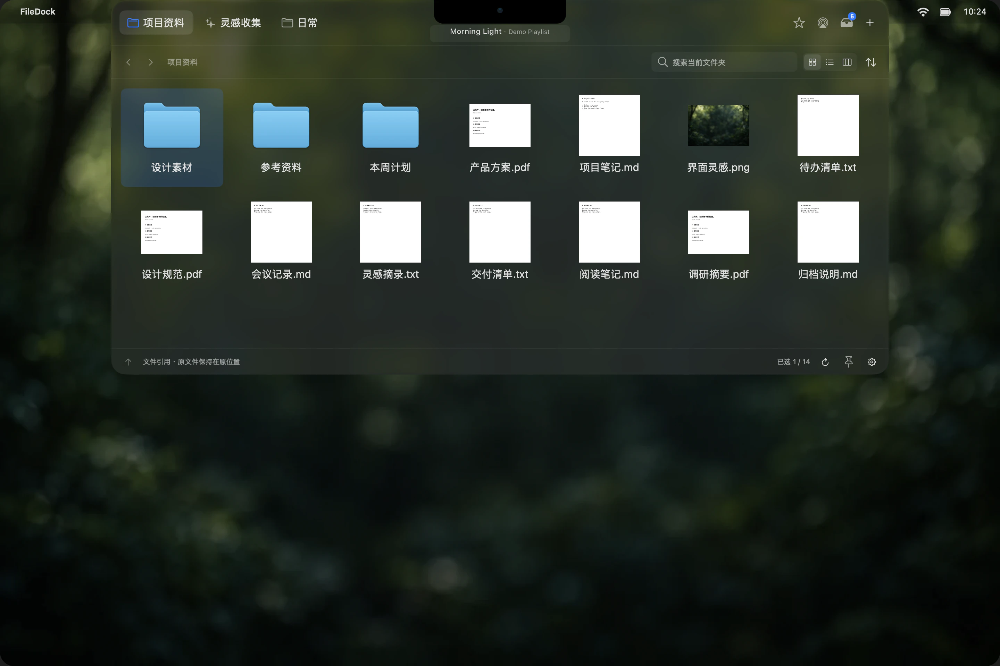
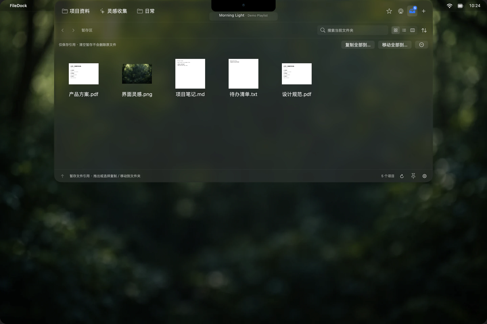
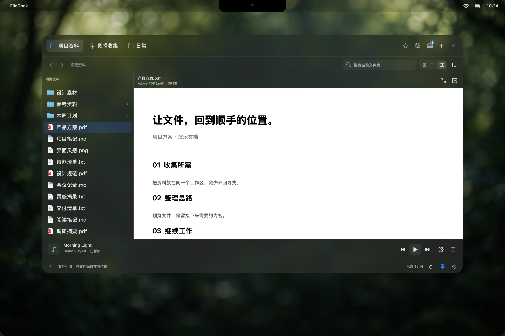

# FileDock

**简体中文**　|　[English](README_EN.md)

### 文件，就在手边。

从刘海或屏幕边角展开的原生 macOS 文件工作区。 
常用目录、临时文件、文档预览与音乐控制，在一个顺手的位置。

**[下载最新版](https://github.com/Die-Xie/FileDock/releases/latest)**　·　[使用指南](docs/GUIDE.md)　·　[反馈与建议](https://github.com/Die-Xie/FileDock/issues)

macOS 13+　 /　 Apple Silicon & Intel　 /　 中英文界面　 /　 Apache 2.0

当前源码的原生界面渲染，使用演示文件与展示背景。实际外观随系统版本和设置变化。

## 少一点寻找，多一点专注

项目资料放一个标签，灵感和日常文件各有位置。需要时移入刘海、触发边角，或按下快捷键；从顶栏把面板拖出来，它就会自动固定，陪你完成这轮整理。

拖文件夹到标签间隙或首尾，可以直接创建新工作区。收藏、最近使用、暂存和 AirDrop 可以固定在右上角，按自己的习惯排列，也可以随时隐藏。

## 先接住，再归位

从几个文件夹里挑资料，先放进**暂存区**。文件、文件夹、文稿包都能收集；找到目标后，再拖出去，或批量复制、移动到需要的位置。

**本地文件以引用暂存，清空列表不会删除原文件。** 剪贴板中的文件和图片也能粘贴进来；网页图片和应用提供的临时文件，会先保存到本机。需要发给附近设备时，把文件拖到 **AirDrop** 图标，再选择接收方即可。

## 看清楚，再继续

网格找图片，列表比较日期和大小，分栏逐层浏览、直接阅读。按空格进入快速查看，按 Enter 原位改名；框选、多选拖放、拷贝粘贴和移到废纸篓，都延续熟悉的 Finder 操作习惯。

右键文件夹可以更改颜色标签，添加图案、表情或图片图标，变化同步到 Finder。简介、压缩、制作副本、制作替身和终端入口也都在右键菜单里。

音乐也留在手边：支持 **QQ 音乐、系统“音乐”和网易云音乐**。刘海中显示曲名，悬停后出现播放控制；拖出固定后使用底部播放栏。能读取时间的播放器显示真实进度，不支持时隐藏。

## 按自己的节奏使用

| 使用习惯 | 可以这样设置 |
| --- | --- |
| 随手打开，用完收起 | 刘海悬停、刘海点按、四角触发或全局快捷键；延迟连续可调 |
| 整理时需要更多空间 | 拖出面板自动固定；拖出文件时可自动收起，拖回触发处再展开 |
| 游戏和视频时少受打扰 | 全屏与应用黑名单限制；可临时改用点击呼出 |
| 文件更好找 | 标签与固定入口拖动换序、图标模式、列表列标题排序、文件夹优先可选 |
| 外观与桌面协调 | 深色液态玻璃，或随系统明暗变化的纯色主题 |
| 保留自己的工作方式 | 中英文即时切换，本地保存工作区与偏好，支持配置导入和导出 |

大目录分批显示，读取期间仍可切换工作区。真实刘海支持调整鼠标进入比例，也可局部过滤顶边拖动，减少与系统调度中心的冲突。

## 三步开始

1. **安装**：从 [最新 Release](https://github.com/Die-Xie/FileDock/releases/latest) 下载 `FileDock.zip`，解压后将 `FileDock.app` 放入「应用程序」。
2. **加入常用内容**：点击 **＋** 添加文件夹或文件引用合集，并选择需要显示的快捷入口。
3. **选好打开方式**：默认 **⌘⌥↓** 在触发位置呼出，**⌘⌥→** 在光标旁呼出；可在设置中重新录制，也可使用刘海或边角。

无需注册账号，工作区与偏好保存在本机，不收集使用遥测。提供 Apple Silicon / Intel 通用版本；当前发行包已签名，**尚未经过 Apple 公证**。

液态玻璃在 macOS 26 使用原生效果，较早系统使用模糊材质。播放器连接与授权在「设置 → 音乐」中完成，读取能力取决于客户端；预览格式取决于系统 Quick Look 与已安装扩展。可在「设置 → 关于」中检查和安装更新。

**[查看完整使用指南 →](docs/GUIDE.md)**

开发、构建与发布

FileDock 使用 Swift、AppKit 与 SwiftUI 构建。源码、测试与发布工具都在本仓库中，编译产物通过 Release 提供。

- [从源码构建与签名](docs/BUILDING.md)
- [发布流程](docs/RELEASING.md)
- [质量与性能审查记录](docs/QUALITY_REVIEW.md)
- [版本发布说明](docs/releases/)

1.30.1 新增刘海顶边局部拖动过滤，解决系统多桌面冲突，并保留 Finder 首次移入的完整移动以避免回弹。详见 [版本说明](docs/releases/v1.30.1.md)。

1.30.0 新增文件夹样式编辑、系统颜色标签，以及简介、压缩、副本、替身和终端等 Finder 操作。详见 [版本说明](docs/releases/v1.30.0.md)。

1.29.0 支持拖动文件夹到标签间隙或首尾新建标签，并显示插入细线和松手提示。详见 [版本说明](docs/releases/v1.29.0.md)。

1.28.1 支持连续调节刘海鼠标进入比例，超过 100% 时可设置完全进入后继续深入的距离。详见 [版本说明](docs/releases/v1.28.1.md)。

1.28.0 新增中英文界面切换，并整理全屏与应用限制的呼出设置文案。详见 [版本说明](docs/releases/v1.28.0.md)。

1.27.0 允许全屏或命中黑名单时改用点按呼出，离开例外环境后恢复原来的呼出方式。详见 [版本说明](docs/releases/v1.27.0.md)。

1.26.2 支持拖到系统废纸篓删除原文件，并同步清理收藏、暂存中的相关引用。详见 [版本说明](docs/releases/v1.26.2.md)。

1.26.1 支持同一次文件拖动中，拖出收起、拖回刘海或已设置边角重新展开。详见 [版本说明](docs/releases/v1.26.1.md)。

1.26.0 支持拖出文件时自动收起面板，露出被遮挡的投放区域；可在设置中关闭。详见 [版本说明](docs/releases/v1.26.0.md)。

1.25.1 支持 Finder 式原位重命名：Return / Enter 编辑所选文件名，默认保留扩展名。详见 [版本说明](docs/releases/v1.25.1.md)。

1.25.0 支持系统剪贴板文件与图片粘贴，包含收藏和暂存区，并兼容文件区 Ctrl+C / Ctrl+V。详见 [版本说明](docs/releases/v1.25.0.md)。

1.24.0 为系统音乐加入真实播放进度，缺少时间数据时隐藏进度条；设置侧栏新增退出入口。详见 [版本说明](docs/releases/v1.24.0.md)。

1.23.0 移除趣味动画，设置改用侧栏分类与统一分组，集中管理呼出延迟和文件快捷入口。详见 [版本说明](docs/releases/v1.23.0.md)。

1.22.1 补齐顶栏空白区域的面板拖动，并支持连续调整工作区悬停延迟、毫秒读数及结束后合并保存。详见 [版本说明](docs/releases/v1.22.1.md)。

1.22.0 优化标签、固定入口和视图模式的选中过渡，减少加载提示闪现，音乐悬停恢复原滚动位置。动效限制在轻量反馈层，保留文件拖放实例及几何。详见 [版本说明](docs/releases/v1.22.0.md)。

1.21.5 补齐固定图标及普通标签的间隙、首尾拖放接收区，并统一插入引导与实际落点。详见 [版本说明](docs/releases/v1.21.5.md)。

1.21.4 补齐收藏取消固定后的隐藏行为，并支持拖动右上角功能图标、自动保存顺序。详见 [版本说明](docs/releases/v1.21.4.md)。

1.21.3 让取消固定的最近使用完全隐藏，并在「＋」菜单加入与设置同步的 AirDrop 开关。详见 [版本说明](docs/releases/v1.21.3.md)。

1.21.2 支持直接拖文件到 AirDrop 图标，并将最近使用统一为「＋」菜单内的可勾选功能项。详见 [版本说明](docs/releases/v1.21.2.md)。

1.21.1 将 AirDrop 快捷入口移到收藏旁，并支持把最近使用固定到右上角。详见 [版本说明](docs/releases/v1.21.1.md)。

1.21.0 新增多播放器选择与 AirDrop，并修复分批加载期间重排丢引用、配置导入竞态和文件夹识别降级问题。详见 [版本说明](docs/releases/v1.21.0.md)。

1.20.1 进一步优化最近使用、批量保存及后台文件操作。详见 [复审说明](docs/releases/v1.20.1.md)。

1.20.0 优化万项目录的分批加载、后台排序和刷新成本，并让应用程序略览只显示图标与信息。详见 [版本说明](docs/releases/v1.20.0.md)。

1.18.0 支持文件框选及拖文件悬停切换工作区，修复快捷入口裁剪，以及快速查看、设置打开时的顶部菜单栏遮挡。详见 [版本说明](docs/releases/v1.18.0.md)。

1.18.1 根据实际反馈补充 SVG 原文件暂存、快速查看层级修复与拖拽期间的图标加载优化。详见 [版本说明](docs/releases/v1.18.1.md)。

1.17.1 修复标签悬停切换时同步目录扫描导致的卡死。首次载入、切换、路径跳转与刷新统一使用后台加载器；当前版本在连续 5 秒无读取进展后显示重试入口，可继续切换工作区。实际未完成读取最多 3 个，超时/取消不提前释放仍在系统调用中的槽位；定时刷新不会反复重试已超时的目录。详见 [现场诊断与测试](docs/HANG_DIAGNOSIS.md)。

---

由 <a href="https://github.com/Die-Xie">Diexie</a> 制作 
Copyright © 2026 Diexie. · <a href="LICENSE">Apache License 2.0</a>

