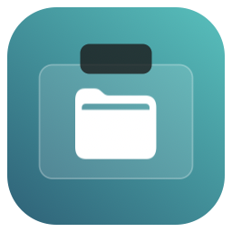
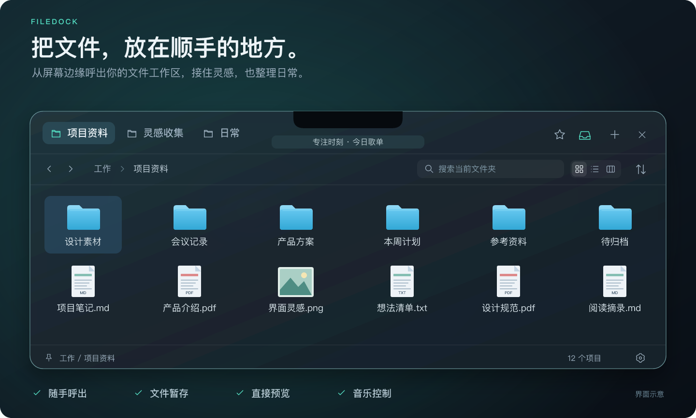
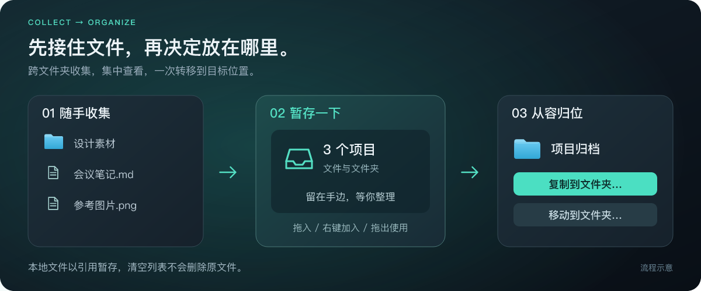
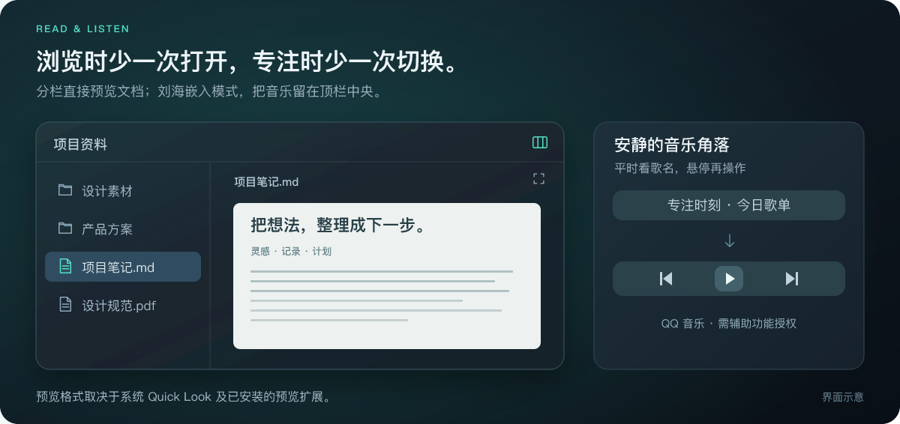

# FileDock

### 文件，就在手边。

一个藏在屏幕边缘的原生 macOS 文件工作区。 
随手呼出、临时暂存、直接预览，让整理文件融入手边的工作。

**[下载 FileDock](https://github.com/Die-Xie/FileDock/releases/latest)**　·　[使用指南](docs/GUIDE.md)　·　[反馈与建议](https://github.com/Die-Xie/FileDock/issues)

macOS 13+　 /　 Apple Silicon & Intel　 /　 Apache 2.0

界面示意，使用通用示例文件绘制；实际外观随系统版本、主题及布局设置而变化。

## 给常用文件，一个顺手的位置

写方案时的参考资料，设计时的图片素材，刚下载还没来得及整理的文档——把它们放进 FileDock 的工作区，需要时就能找到。

常用文件夹可以成为独立标签，零散文件可以收进「收藏」，「最近使用」则帮你回到刚打开的文档。工作区顺序、图标和显示方式，都由你安排。

## 随手呼出，用完收起

把鼠标移到刘海或屏幕角落，工作区就从对应位置展开。也可以用快捷键，在触发位置或光标旁打开。

- **贴合你的屏幕**：刘海支持曲线衔接与嵌入布局，也能选择四角触发。
- **跟上你的节奏**：呼出延迟、收起延迟、动画速度均可调；刘海还可切换为点按唤醒。
- **需要时留在桌面**：从顶部空白处拖出面板会自动固定，方便持续整理与拖放。
- **专注时少受打扰**：为游戏、播放器等应用设置自动呼出黑名单，或在全屏时暂停鼠标触发。

## 先收集，再从容归位

从几个文件夹里挑资料，或把临时下载的内容归到项目中，先拖进「暂存区」就好。文件、文件夹、文稿包都能收集，之后再拖出使用，或批量复制、移动到目标位置。

**本地文件以引用暂存，清空列表不会删除原文件。** 网页图片和应用提供的临时文件会先保存到本机，再加入暂存。暂存入口可随时关闭，已收集的内容仍会保留。

## 浏览文件，也照顾阅读和音乐

网格适合找图片，列表方便查看日期与大小，分栏让你逐层浏览目录。选中文件就能在侧边预览，图片、PDF、文本文档等内容可以直接查看；需要放大时，再按空格快速查看。

听歌时，**QQ 音乐、系统音乐和网易云音乐**也在手边。「设置 → 音乐」可指定播放器或自动选择正在播放的应用。刘海嵌入模式显示歌曲信息，长曲名自动滚动，鼠标移入后出现播放控制；其他布局使用底部播放栏。系统音乐使用自动化权限，QQ 与网易云音乐使用辅助功能；网易云音乐的控制与曲名读取取决于客户端提供的原生菜单和窗口信息。

要发送到附近的 Apple 设备，可将文件直接拖到收藏旁的 **AirDrop** 图标，或先选中文件再点击按钮，在系统面板中选择接收方。支持从暂存区批量发送，可在 **＋** 菜单或设置中关闭入口。

新安装使用 Diexie 的当前偏好：液态玻璃、刘海嵌入、即时呼出和收回、1.3 倍动画速度，开启音乐、收藏、暂存和开机启动；文件按修改日期降序混排。这些选项均可在设置中调整，已有配置会继续保留。默认设置不包含个人路径、书签或系统授权。

预览格式取决于系统 Quick Look 与已安装扩展；音乐连接状态及重连入口也在「设置 → 音乐」中。

## 按你的习惯，摆成你的样子

| 你想怎样使用 | FileDock 可以这样配合 |
| --- | --- |
| 桌面更有质感 | 深色液态玻璃，或随系统明暗变化的纯色主题 |
| 常用内容更好找 | 拖动工作区或固定图标排序、仅显示图标、收藏与暂存入口 |
| 文件整理更直接 | 拖动文件排序、多选拖出、复制粘贴、右键操作 |
| 路径跳转更顺手 | 可点击的面包屑路径、前后历史、⌘↑ / ⌘↓ 导航 |
| 设置留在自己手里 | 本地保存工作区与偏好，支持导入、导出配置 |

无需注册账号。工作区配置保存在本机，不包含遥测、订阅或账号服务。

## 三步，开始使用

1. **下载并安装**：从 [最新 Release](https://github.com/Die-Xie/FileDock/releases/latest) 下载 `FileDock.zip`，解压后将 `FileDock.app` 放入「应用程序」。
2. **加入常用内容**：点击右上角 **＋** 添加文件夹工作区或文件引用合集；收藏、最近使用、暂存和 AirDrop 通过同一菜单的勾选项管理。取消固定收藏或最近使用后会完全隐藏，不再变成普通标签。右上角功能图标可拖动排序。
3. **选一个顺手的入口**：在设置中选择刘海、屏幕角落或快捷键。默认 **⌘⌥↓** 呼出工作区，**⌘⌥→** 在光标旁呼出；两组快捷键都可以重新录制。

支持 **macOS 13 及以上**，提供 Apple Silicon 与 Intel 通用版本。液态玻璃在 macOS 26 使用原生效果，较早系统使用模糊材质。当前发行包已签名，**尚未经过 Apple 公证**；从 1.19 起可在「设置 → 关于」或菜单栏中检查、下载并安装新版；更早版本需先手动替换「应用程序」中的同一份 FileDock。

想了解暂存规则、文件拖放、快捷键或音乐连接？请看 **[使用指南 →](docs/GUIDE.md)**

开发、构建与发布

FileDock 使用 Swift、AppKit 与 SwiftUI 构建。源码、测试与发布工具都在本仓库中，编译产物通过 Release 提供。

- [从源码构建与签名](docs/BUILDING.md)
- [发布流程](docs/RELEASING.md)
- [质量与性能审查记录](docs/QUALITY_REVIEW.md)
- [版本发布说明](docs/releases/)

1.25.0 支持系统剪贴板文件与图片粘贴，包含收藏和暂存区，并兼容文件区 Ctrl+C / Ctrl+V。详见 [版本说明](docs/releases/v1.25.0.md)。

1.24.0 为系统音乐加入真实播放进度，缺少时间数据时隐藏进度条；设置侧栏新增退出入口。详见 [版本说明](docs/releases/v1.24.0.md)。

1.23.0 移除趣味动画，设置改用侧栏分类与统一分组，集中管理呼出延迟和文件快捷入口。详见 [版本说明](docs/releases/v1.23.0.md)。

1.22.1 补齐顶栏空白区域的面板拖动，并支持连续调整工作区悬停延迟、毫秒读数及结束后合并保存。详见 [版本说明](docs/releases/v1.22.1.md)。

1.22.0 优化标签、固定入口和视图模式的选中过渡，减少加载提示闪现，音乐悬停恢复原滚动位置。动效限制在轻量反馈层，保留文件拖放实例及几何。详见 [版本说明](docs/releases/v1.22.0.md)。

1.21.5 补齐固定图标及普通标签的间隙、首尾拖放接收区，并统一插入引导与实际落点。详见 [版本说明](docs/releases/v1.21.5.md)。

1.21.4 补齐收藏取消固定后的隐藏行为，并支持拖动右上角功能图标、自动保存顺序。详见 [版本说明](docs/releases/v1.21.4.md)。

1.21.3 让取消固定的最近使用完全隐藏，并在「＋」菜单加入与设置同步的 AirDrop 开关。详见 [版本说明](docs/releases/v1.21.3.md)。

1.21.2 支持直接拖文件到 AirDrop 图标，并将最近使用统一为「＋」菜单内的可勾选功能项。详见 [版本说明](docs/releases/v1.21.2.md)。

1.21.1 将 AirDrop 快捷入口移到收藏旁，并支持把最近使用固定到右上角。详见 [版本说明](docs/releases/v1.21.1.md)。

1.21.0 新增多播放器选择与 AirDrop，并修复分批加载期间重排丢引用、配置导入竞态和文件夹识别降级问题。详见 [版本说明](docs/releases/v1.21.0.md)。

1.20.1 进一步优化最近使用、批量保存及后台文件操作。详见 [复审说明](docs/releases/v1.20.1.md)。

1.20.0 优化万项目录的分批加载、后台排序和刷新成本，并让应用程序略览只显示图标与信息。详见 [版本说明](docs/releases/v1.20.0.md)。

1.18.0 支持文件框选及拖文件悬停切换工作区，修复快捷入口裁剪，以及快速查看、设置打开时的顶部菜单栏遮挡。详见 [版本说明](docs/releases/v1.18.0.md)。

1.18.1 根据实际反馈补充 SVG 原文件暂存、快速查看层级修复与拖拽期间的图标加载优化。详见 [版本说明](docs/releases/v1.18.1.md)。

1.17.1 修复标签悬停切换时同步目录扫描导致的卡死。首次载入、切换、路径跳转与刷新统一使用后台加载器；当前版本在连续 5 秒无读取进展后显示重试入口，可继续切换工作区。实际未完成读取最多 3 个，超时/取消不提前释放仍在系统调用中的槽位；定时刷新不会反复重试已超时的目录。详见 [现场诊断与测试](docs/HANG_DIAGNOSIS.md)。

---

由 <a href="https://github.com/Die-Xie">Diexie</a> 制作 
Copyright © 2026 Diexie. · <a href="LICENSE">Apache License 2.0</a>

