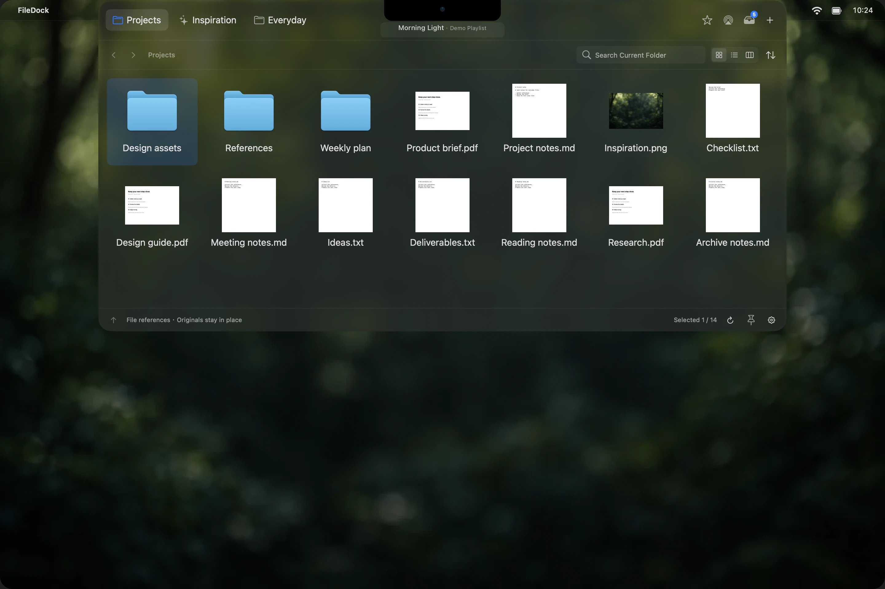
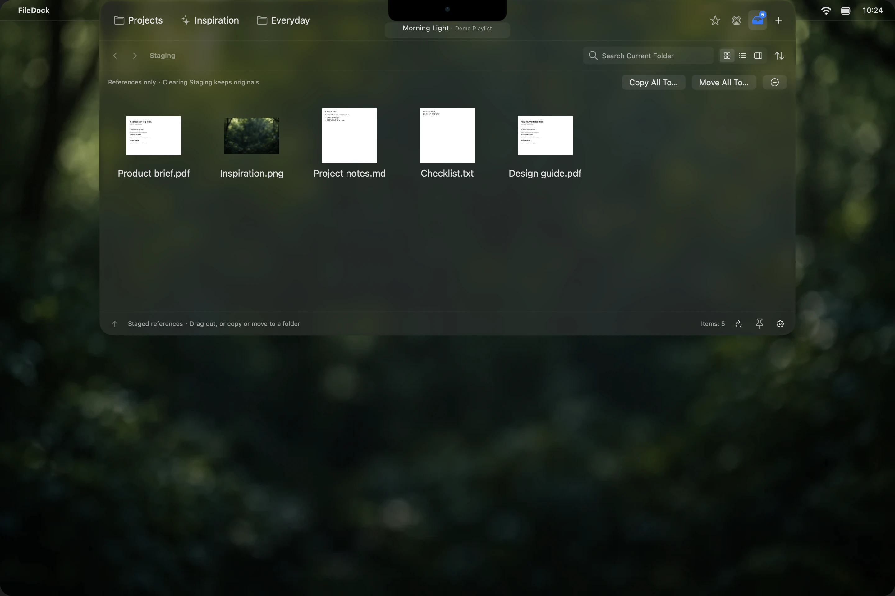
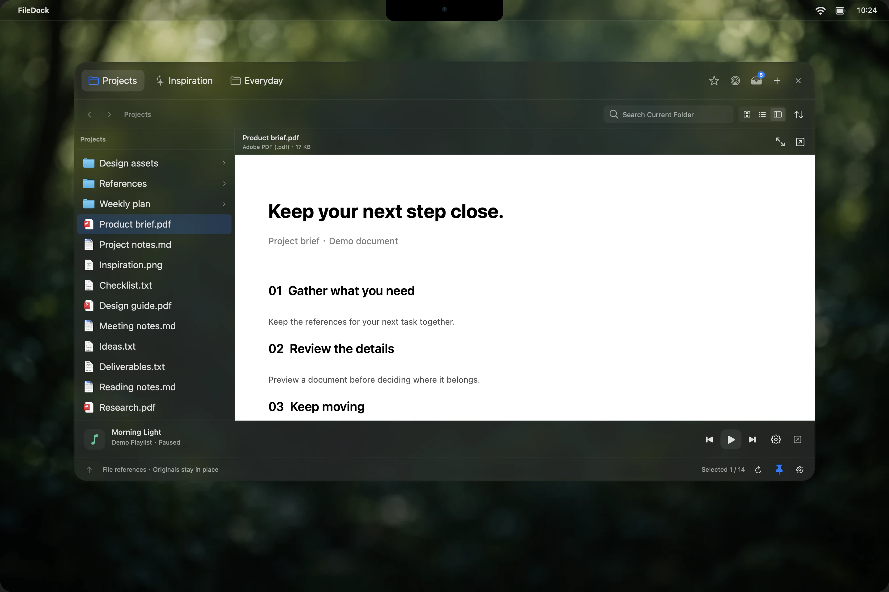

# FileDock

[简体中文](README.md)　|　**English**

### Your files, within reach.

A native macOS file workspace that opens from the notch or a screen corner. 
Keep everyday folders, temporary files, document previews, and music controls close.

**[Download the latest release](https://github.com/Die-Xie/FileDock/releases/latest)**　·　[User guide (Chinese)](docs/GUIDE.md)　·　[Feedback & issues](https://github.com/Die-Xie/FileDock/issues)

macOS 13+　 /　 Apple Silicon & Intel　 /　 Chinese & English　 /　 Apache 2.0

Rendered from the current native interface with demonstration files and a presentation background. Appearance varies with macOS and your settings.

## Less searching, more doing

Give project references their own tab, with separate places for inspiration and everyday files. Move into the notch, use a screen corner, or press a shortcut to open the panel. Drag it out by the header to pin it while you organize.

Drop folders between tabs or at either end to create workspaces. Pin Favorites, Recents, Staging, and AirDrop at the top right, arrange them to suit your routine, or hide the entries you do not need.

## Collect first. Put away later.

Gather files from several folders in **Staging**. Files, folders, and document packages can all be collected. Once you find the destination, drag them out or copy or move the batch there.

**Local files are staged as references. Clearing the list does not delete the originals.** Paste files and images from the clipboard too; web images and temporary files supplied by apps are saved locally first. To send files to a nearby device, drop them onto **AirDrop**, then choose a recipient.

## See the details. Keep moving.

Browse images in a grid, compare dates and sizes in a list, or explore folders and read documents in columns. Press Space for Quick Look or Enter to rename in place. Marquee selection, multiple-file dragging, copy and paste, and moving items to Trash follow familiar Finder conventions.

Right-click a folder to change its color label or add a symbol, emoji, or image icon. Changes appear in Finder too. The menu also includes Get Info, Compress, Duplicate, Make Alias, and Open in Terminal.

Keep **QQ Music, Apple's Music app, and NetEase Cloud Music** close. Track information sits in the notch and reveals controls on hover; a pinned floating panel uses a playback bar at the bottom. Real playback progress appears only when the player provides timing data.

## Make it fit your routine

| Your routine | Your options |
| --- | --- |
| Open quickly, put away easily | Notch hover or click, four screen corners, or global shortcuts, with continuous delay controls |
| Make room while organizing | Drag the panel out to pin it; optionally hide it during an outgoing file drag and reopen at the trigger |
| Stay focused in games and video | Full-screen and app restrictions, with optional temporary click activation |
| Find files your way | Reorder tabs and pinned entries, use icon-only tabs, sort by list headers, and choose whether folders come first |
| Match your desktop | Dark Liquid Glass or a solid theme that follows light and dark appearance |
| Keep your own setup | Switch Chinese and English instantly; save preferences locally and import or export configuration |

Large folders appear in batches while you remain free to switch workspaces. On a physical notch, adjust the pointer-entry threshold and optionally filter top-edge drags to avoid Mission Control conflicts.

## Start in three steps

1. **Install:** download `FileDock.zip` from the [latest release](https://github.com/Die-Xie/FileDock/releases/latest), extract it, and move `FileDock.app` to Applications.
2. **Add everyday files:** use **＋** to add folders or collections of file references and choose which shortcuts to show.
3. **Choose how to open:** by default, **⌘⌥↓** opens at the trigger and **⌘⌥→** opens beside your pointer. Reassign them in Settings, or use the notch or a screen corner.

No account is required. Workspaces and preferences stay on your Mac, and FileDock collects no usage telemetry. Releases are universal builds for Apple Silicon and Intel, signed but **not yet notarized by Apple**.

Liquid Glass uses the native effect on macOS 26 and blurred material on earlier systems. Connect players and manage permissions in Settings → Music; available information depends on the client. Preview formats depend on macOS Quick Look and installed extensions. Check for and install updates in Settings → About.

**[Read the full user guide (Chinese) →](docs/GUIDE.md)**

Development, builds, and releases

FileDock is built with Swift, AppKit, and SwiftUI. This repository contains the source code, tests, and release tools. Compiled applications are available in Releases.

The following technical documents and most earlier release notes are currently in Chinese:

- [Build from source and sign the app](docs/BUILDING.md)
- [Release workflow](docs/RELEASING.md)
- [Code quality and performance review](docs/QUALITY_REVIEW.md)
- [Release notes](docs/releases/)

**1.30.3** fixes filename tooltips failing to appear by bounding SwiftUI tracking regions and handling pointer movement after layout changes. [Release notes](docs/releases/v1.30.3.md).

**1.30.2** shows pointer-following tooltips only for truncated filenames in grid, list, columns, and preview titles, with tooltips updated after renaming. [Release notes (Chinese / English)](docs/releases/v1.30.2.md).

**1.30.1** adds notch-only top-edge drag filtering to prevent Mission Control conflicts, while preserving the full first-arrival movement from Finder to avoid rebound. [Release notes (Chinese / English)](docs/releases/v1.30.1.md).

**1.30.0** adds folder styling, system color labels, and Finder operations including Get Info, Compress, Duplicate, Make Alias, and Open in Terminal. [Release notes](docs/releases/v1.30.0.md).

**1.29.0** lets you create folder tabs by dropping folders between tabs or at either end, with an insertion line and release prompt. [Release notes](docs/releases/v1.29.0.md).

**1.28.1** adds continuous adjustment of notch pointer entry. Values above 100% require the pointer to move farther inward after fully entering. [Release notes](docs/releases/v1.28.1.md).

**1.28.0** adds Chinese and English interface switching and clearer activation settings for full screen and blocked apps. [Release notes](docs/releases/v1.28.0.md).

**1.27.0** allows temporary click activation in full screen or a blocked app, then restores the normal activation mode when that restriction ends. [Release notes](docs/releases/v1.27.0.md).

**1.26.2** supports dragging files to the system Trash and removes corresponding references from Favorites and Staging. [Release notes](docs/releases/v1.26.2.md).

**1.26.1** lets the panel close when a file is dragged out, then reopen when the same drag returns to the notch or configured corner. [Release notes](docs/releases/v1.26.1.md).

**1.26.0** can hide the panel during an outgoing file drag to uncover the destination beneath it. This behavior can be disabled in Settings. [Release notes](docs/releases/v1.26.0.md).

**1.25.1** adds Finder-style inline renaming: Return / Enter edits the selected filename and preserves its extension by default. [Release notes](docs/releases/v1.25.1.md).

**1.25.0** adds clipboard pasting for files and images, including Favorites and Staging, and supports Ctrl+C / Ctrl+V in the file area. [Release notes](docs/releases/v1.25.0.md).

**1.24.0** adds real playback progress for Music, hides progress when timing data is unavailable, and adds Quit to the Settings sidebar. [Release notes](docs/releases/v1.24.0.md).

**1.23.0** removes novelty animations and reorganizes Settings with sidebar categories and consistent groups for activation delays and file shortcuts. [Release notes](docs/releases/v1.23.0.md).

**1.22.1** restores panel dragging across empty header areas and adds continuous workspace hover delay adjustment with millisecond values and a single save after adjustment. [Release notes](docs/releases/v1.22.1.md).

**1.22.0** improves selection transitions for tabs, pinned entries, and view modes; reduces brief loading flashes; and resumes music text scrolling from its previous position after hover. Animations stay within lightweight feedback layers while file drag destinations and geometry remain stable. [Release notes](docs/releases/v1.22.0.md).

**1.21.5** completes gap and end drop zones for pinned icons and regular tabs, keeping insertion guidance aligned with the final position. [Release notes](docs/releases/v1.21.5.md).

**1.21.4** fully hides Favorites when unpinned and adds drag reordering with saved order for the top-right function icons. [Release notes](docs/releases/v1.21.4.md).

**1.21.3** fully hides Recents when unpinned and adds an AirDrop toggle to the ＋ menu that stays in sync with Settings. [Release notes](docs/releases/v1.21.3.md).

**1.21.2** supports dropping files directly onto AirDrop and makes Recents a checkbox option in the ＋ menu. [Release notes](docs/releases/v1.21.2.md).

**1.21.1** moves the AirDrop shortcut beside Favorites and lets you pin Recents at the top right. [Release notes](docs/releases/v1.21.1.md).

**1.21.0** introduces multiple music players and AirDrop, and fixes lost references during reordering while loading, configuration import races, and folder recognition fallbacks. [Release notes](docs/releases/v1.21.0.md).

**1.20.1** further improves Recents, batched persistence, and background file operations. [Review notes](docs/releases/v1.20.1.md).

**1.20.0** improves batched loading, background sorting, and refresh costs for folders containing tens of thousands of items. Application previews show only icons and information. [Release notes](docs/releases/v1.20.0.md).

**1.18.0** adds marquee selection and workspace switching during file drags, and fixes clipped shortcuts and menu-bar overlap when opening Quick Look or Settings. [Release notes](docs/releases/v1.18.0.md).

**1.18.1** adds original SVG staging, Quick Look window-level fixes, and more efficient icon loading during drags in response to user feedback. [Release notes](docs/releases/v1.18.1.md).

**1.17.1** fixes hangs caused by synchronous directory scans during hover switching. Initial loading, workspace changes, path navigation, and refreshes all use background loading. The current version offers a retry after five seconds without read progress, while allowing workspace switching. At most three actual reads can remain unfinished; timeout or cancellation does not release a slot while its system call is still running. Periodic refresh does not repeatedly retry timed-out folders. [Diagnosis and tests](docs/HANG_DIAGNOSIS.md).

---

Made by <a href="https://github.com/Die-Xie">Diexie</a> 
Copyright © 2026 Diexie. · <a href="LICENSE">Apache License 2.0</a>

